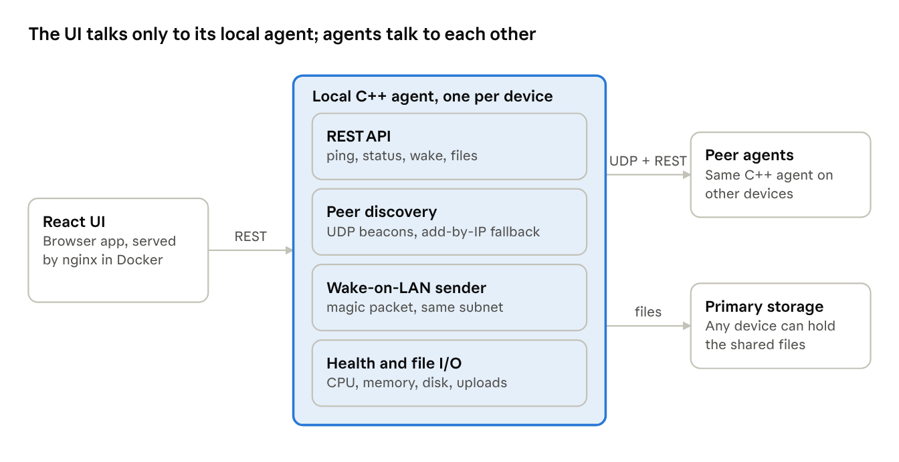

# Architecture and API planning

Source: [File Transfer Across Network](sources/file-transfer-across-network.pdf), pages 2–3; initial endpoint list on page 4; recorded decisions on page 5.

## Current decision: shared registration backend

Confirmed November 23, 2026, after the source proposal: build the shared backend in **Java with Spring Boot**, in the repository's `backend/` directory. The native device agents remain C++.

The backend maintains persistent device registrations and group membership in PostgreSQL. Administrators create groups and single-use, expiring invitations. The C++ agent sends a display name and invitation token to `POST /devices/register`; the backend returns a generated device ID, group ID, and device token. The database stores the token's hash, and the agent saves the returned identity in `agent/registration.json`. Device identity is independent of its IP address.

Docker Compose runs Spring Boot and PostgreSQL together locally, with a persistent database volume. The local API uses HTTP and JSON; the agent uses libcurl and nlohmann/json. Authentication with saved credentials, revocation, and presence tracking remain future work. Hosting and HTTPS deployment must be selected before exposing registration across networks.

**File transfers will be peer to peer, directly between C++ agents. File contents will not pass through the Spring Boot backend or be stored in its PostgreSQL database.** The backend handles registration and group membership; file streaming belongs to the agents and is not implemented yet. Internet-accessible registration does not itself provide remote connectivity between agents, which remains future work.

The sections below preserve the original proposal. Its discovery approach without a central server describes LAN peer discovery; it does not replace the newly selected shared registration backend. Its architecture figure predates this decision.

## Component responsibilities

The [approved UI design](ui-design.md) adds a virtual device/folder namespace, explorer-based cross-device copying, Devices-based folder sharing, and an initially serial transfer queue. These are intended behaviors; queue ownership, remote sharing permissions, and the corresponding agent contracts remain to be specified. The homepage's branching graph is a presentation choice, not a requirement to relay transfers through the current device.

**The browser UI only calls the agent on its own device. Agents perform all device-to-device work.** The UI displays only what its local agent reports, so the same UI can work on any device.

The figure above is preserved from page 2 of the source PDF.

| Component | Responsibility |
| --- | --- |
| React UI | Browser app served by nginx in Docker; calls the local agent through REST. |
| Local C++ agent | One native agent per device; exposes REST endpoints and coordinates local health, file operations, discovery, and wake requests. |
| Peer discovery | UDP beacons with manual add-by-IP fallback; mDNS is a possible alternative if time allows. |
| Wake-on-LAN sender | Sends a UDP broadcast magic packet on the same subnet. |
| Health and file I/O | Reports CPU, memory, and disk data and handles uploads and other file operations. |
| Peer agents | Run the same agent on other devices; communicate through UDP and REST according to the source diagram. |
| Primary storage | Any device can hold shared files; primary storage is a setting on one device. |

## Recorded technical decisions

These are decisions recorded in the PDF, not evidence of completed implementation. The table dates are November 18 in the Fall 2026 proposal.

| Date | Decision | Reason recorded in the source |
| --- | --- | --- |
| November 18, 2026 | Run the C++ agent natively; run only the UI in Docker. | Containers cannot easily send the LAN broadcasts needed for discovery and Wake-on-LAN. |
| November 18, 2026 | Target LAN only for Fall 2026; show remote access as a disabled placeholder. | Keeps scope realistic for about three working weeks. |

The source also proposes that every device run the same agent and that the local agent be the UI's sole source of state. Access control is planned as a shared token, pending instructor confirmation.

## Proposed technologies and tools

The PDF explicitly calls this tool list a proposal and leaves library choices open until prototyping.

| Area | Proposed tools | Purpose |
| --- | --- | --- |
| Agent language and build | C++; POSIX sockets and `std::thread` on Linux/macOS; Winsock and Win32 API on Windows; CMake | Access UDP broadcast, `statvfs`, `/proc`, macOS system calls, and Windows APIs for native network and health operations. |
| Agent HTTP and JSON | Small embedded HTTP library: libmicrohttpd or Mongoose; cJSON | Keep the agent a small single binary with a REST API. |
| Peer discovery | UDP broadcast beacons, or mDNS if time allows; manual add-by-IP fallback | Discover peers on a LAN without a central server. |
| Wake | Wake-on-LAN magic packet over UDP broadcast | Wake a sleeping machine on the same subnet. |
| UI | React with Vite, served by nginx | Support dashboard, detail, storage, upload, and browser screens. |
| Packaging | Docker and Docker Compose | One-command UI startup and a reproducible report demo. |
| Cloud and testing | AWS EC2 or a Docker network running multiple agents | Repeatable peer and storage tests without owning many machines; confirm with the instructor. |
| Source control and CI | GitHub and GitHub Actions | Build agent and UI and provide evidence of progress. |
| Measurement | `iperf3`, `curl`, Wireshark | Establish network baseline, collect timing, and inspect packets. |

## Initial REST API inventory

The setup task is to **define** the contract for the following endpoints. The PDF supplies methods and paths but no request or response schemas. The purposes below summarize the surrounding feature descriptions, not a finalized contract.

| Method | Path | Intended area |
| --- | --- | --- |
| GET | `/ping` | Reachability and the first end-to-end status slice. |
| GET | `/status` | Device status and health. |
| POST | `/wake` | Wake-on-LAN request. |
| GET | `/peers` | Peer listing. |
| GET | `/files` | Shared-folder browsing. |
| POST | `/upload` | File upload. |
| GET | `/download` | File download. |

## Open decisions before implementation

Explicitly unresolved in the source:

- Confirm the proposed shared-token access-control approach with the instructor.
- Select the embedded HTTP library and confirm other library choices through prototyping.
- Resolve UDP discovery versus the optional mDNS alternative.
- Confirm AWS EC2 or Docker-network testing with the instructor.
- Define the REST API contract.

Conversion notes: the following gaps must be specified when designing that contract; they are not additional requirements established by the PDF.

- Device identity, registration, add-by-IP, and wake-target data.
- Peer beacon format, timing, and the rule for declaring a peer offline.
- Endpoints for sharing/unsharing folders, directory creation, disks/mounts, and saving primary storage. These capabilities are in scope but have no paths in the initial inventory.
- Request/response bodies, status codes, error responses, authentication behavior, and file-streaming conventions.
- How the container-served browser UI reaches its host agent, including ports, origin handling, and configuration.
- Allowed filesystem paths and permissions, overwrite behavior, and interrupted-transfer handling.
- How primary storage selection relates to shared folders and how that selection is communicated between peers.

No production deployment procedure or complete API specification is present in the source.
