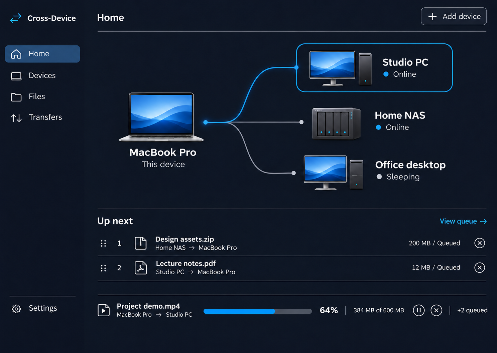
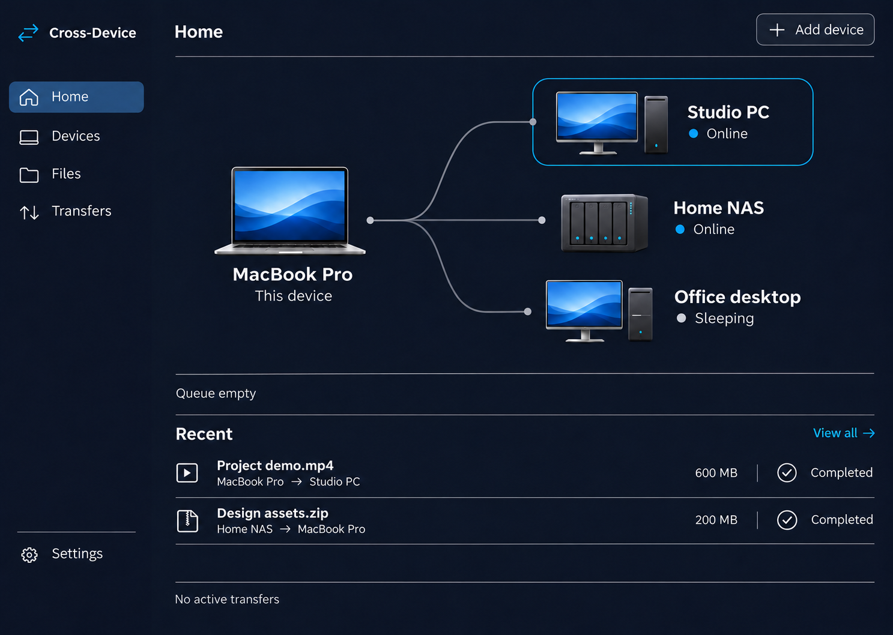
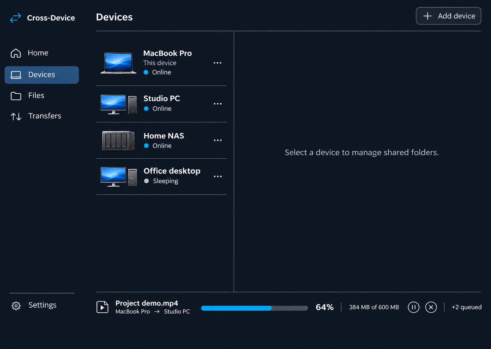
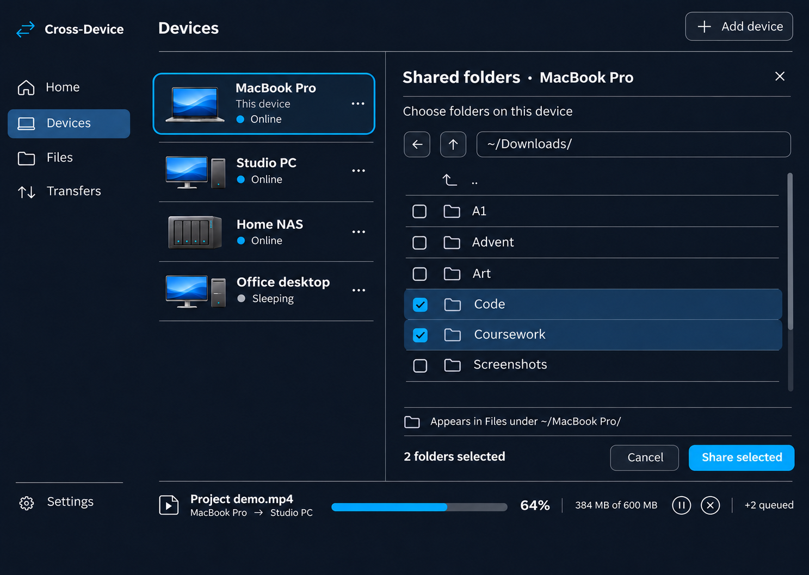
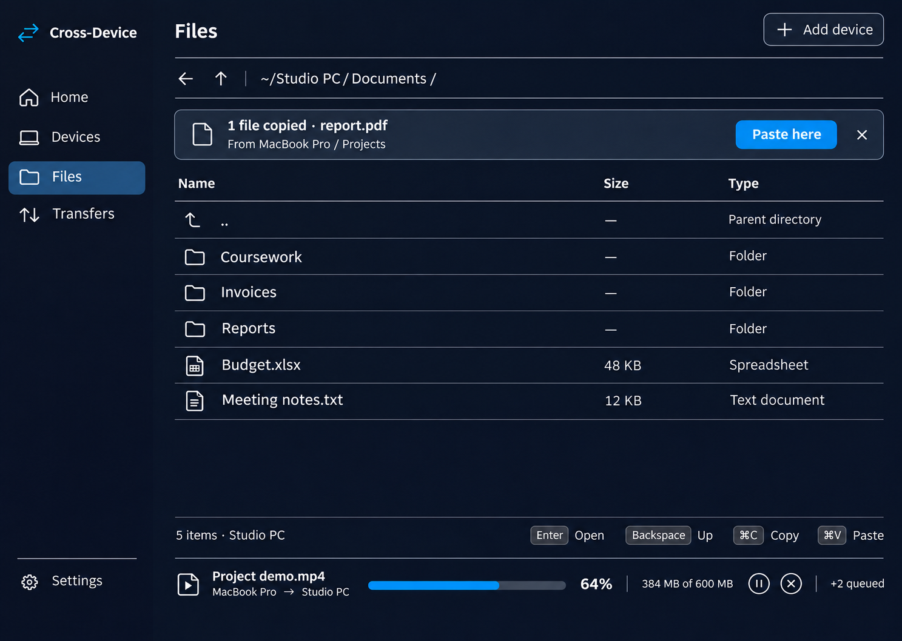
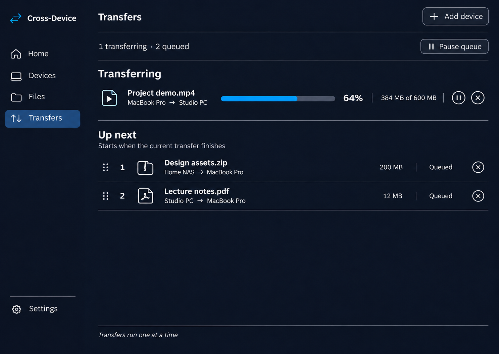

# UI design and interaction decisions

Approved November 23, 2026, through homepage and workflow mockup reviews. These decisions supplement the original proposal; they describe the intended UI, **not implemented functionality**. The six images below are the final approved set. Earlier concepts in the conversation are superseded where they differ.

## Approved mockups

### Home: active transfer and queued jobs

### Home: empty queue

### Devices: no selection

### Devices: folder picker open

### Files

### Transfers

## Shared layout and theme

- The main pages are **Home, Devices, Files, and Transfers**, accessed through a persistent left sidebar. **Settings** sits at the bottom; it replaces the earlier Storage setup navigation label.
- Use dark charcoal surfaces with blue accents, restrained borders, readable text, and simple rows. Purple and orange concepts were rejected. Keep the accent/tint configurable for later theming; a theme selector and alternate themes are not part of this approved screen set.
- The top bar contains the page name and **Add device**. Remove the marketing slogan, global search, network-count toolbar, and global Send files button. Add-device flow details remain to be designed.
- File transfers begin through Files. A persistent bottom bar on Home, Devices, and Files shows the running file's icon/name, source → destination, progress bar, percentage, transferred/total bytes, pause/cancel controls, and queued count.
- On Transfers, show the active job in the main content instead of repeating it in the bottom bar. When no transfer is running, Home uses a small No active transfers footer.
- Mockup names, sizes, folder counts, and device status values are sample data, not hardcoded product requirements. Generated graphics are visual guidance; runtime progress bars must reflect actual progress accurately.

## Home

- Preserve the **original branching graph**: the current device on the left and peer devices stacked on the right, with curved connections and a blue selected/active branch. The later equal-peer grid and mesh layout were not selected.
- Show device names, a This device label, and clear online/sleeping states. The graph provides device availability and transfer context. It does not establish the current device as a mandatory data relay; transfers between two other devices must still be possible.
- Beneath the graph, show **Up next** when jobs are queued. Show queue order, file name/icon, source → destination, size, and queued state, with reorder and cancel controls. View queue opens Transfers.
- When the queue is empty, replace that section with a minimal **Queue empty** message and a short **Recent** list of completed transfers. View all leads to transfer history. Recent transfers were initially rejected as a permanent homepage section; the approved revision uses them only as the empty-queue fallback.
- Do not show pinned folders. The graph and queue/recent section replace that experiment.
- Exact graph interactions, how to display an active transfer between two remote peers within this branching layout, and the fallback when there is no history still need specification.

## Devices and folder sharing

- Keep the device list on the left and a directory/sharing panel on the right.
- With no device selected, show only a small prompt: **Select a device to manage shared folders.** Avoid an illustration or explanatory empty-state section.
- Selecting a device opens its sharing context. The approved open-panel example uses the current MacBook and browses its **real local directory tree**, with a path, back/up navigation, parent entry, folder rows, and checkboxes.
- Folder selection is separate from entering a folder. Users navigate into directories and select the folders they want to expose; the panel shows the selected count and Share selected/Cancel actions.
- Shared folders become visible under that device in Files. Sharing controls belong in Devices, not a separate Shared folders page.
- The mockup shows a close control to return to the no-selection state. Unsharing, existing-share indicators, and permission settings need detailed design.
- Do not infer unrestricted access to another machine's real filesystem from the device list. Remote sharing administration, authorization, and which devices may open a real-files picker remain unresolved.
- Remove the earlier prominent Browse files and Wake device row buttons. This does not cancel the original Wake-on-LAN requirement; its eventual control placement remains open.

## Files: one explorer across devices

- Rename Shared folders to **Files**. Use **one directory view**, not a split-pane transfer interface.
- Present a virtual root `~/` containing device directories. Shared folders appear under their owner, for example `~/Studio PC/Projects/`, with descendants retaining their hierarchy. Device grouping avoids flattening unrelated folders with the same name.
- These paths are an **app navigation namespace**, not a decision to create operating-system mounts or modify the user's actual home directory. Stable device IDs, rather than display names alone, must identify devices internally; escaping, duplicate names, and rename behavior still need specification.
- Use familiar directory navigation: back/up controls, a path/breadcrumb, parent entry, folder/file rows, names, sizes, and types. The mockup includes keyboard hints for opening, going up, copying, and pasting; platform-appropriate shortcut handling remains implementation work.
- To transfer, select a file and **Copy**, navigate to another device/folder, then **Paste here**. A compact clipboard strip retains the file name, source, and selection count while navigating, with a clear action. Pasting queues the transfer; selecting Copy alone does not transfer bytes.
- Copy/paste **preserves the original**. Destructive move/cut behavior is not approved for the initial flow. A native Download/save-dialog shortcut was discussed as an optional possibility, not a committed requirement.
- A user on a Mac can request a Linux → Windows transfer by copying from the Linux share and pasting into the Windows share. The Mac initiates and monitors it, while the file contents travel **directly between the source and destination C++ agents**, not through the Mac or registration backend.
- Both participating agents must be reachable and the operation authorized. Browsing exposes shared folders; a destination must permit writes. Directory transfer semantics, read/write permission controls, overwrite conflicts, offline destinations, and error feedback remain open.

## Transfers and queue behavior

- The approved initial model is **one active transfer with remaining jobs queued in order**. Do not show two partially completed jobs as if both run concurrently. Queued entries have no progress percentage until they start.
- Show the active file's name/icon, source → destination, progress bar, percentage, byte counts, and pause/cancel controls.
- Show Up next as ordered rows with file name/icon, route, size, queued state, reorder grips, and cancellation. Start the next job after the running job completes. Provide a Pause queue control.
- Home and the persistent transfer bar summarize this same state; the Transfers page is the full queue view. A history destination is implied by Home's View all link, although the final Transfers image shows only the active/queued view.
- Queueing is a UI/product decision, not a claim that the current agent implements it. Queue ownership and scope (per controlling agent versus group-wide), persistence, concurrent requests from multiple controllers, pause/resume support, cancellation cleanup, retries, and failure/blocked-job handling must be defined before implementation. In particular, serial behavior across the whole group is not established by these mockups.

## Relationship to the original proposal

The original proposal remains the historical baseline. The registration backend and peer-to-peer data path are documented in [architecture.md](architecture.md). These UI decisions replace the earlier standalone Storage Setup/shared-folders/upload navigation concepts with Settings, Devices-based sharing, and explorer-based copying; they do not silently remove underlying semester requirements such as Wake-on-LAN or directory creation. Settings contents, primary-storage behavior, and directory-creation controls still need design.

The mockups were generated with the built-in image generation tool. Each prompt continued the approved screen references and requested the final blue theme, the page's agreed interactions, and the state illustrated above. The PNGs are review artifacts, not application screenshots or evidence of working transfers.
